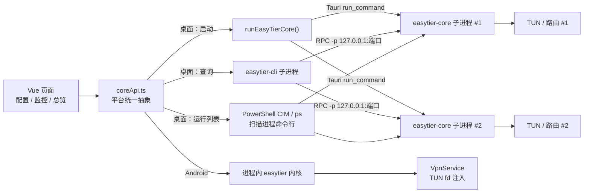
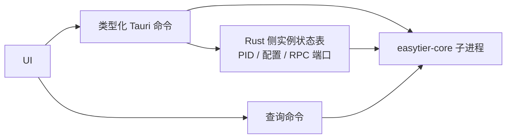
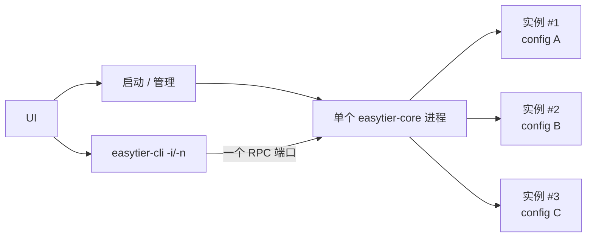
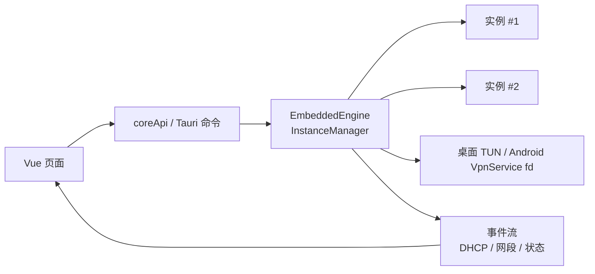
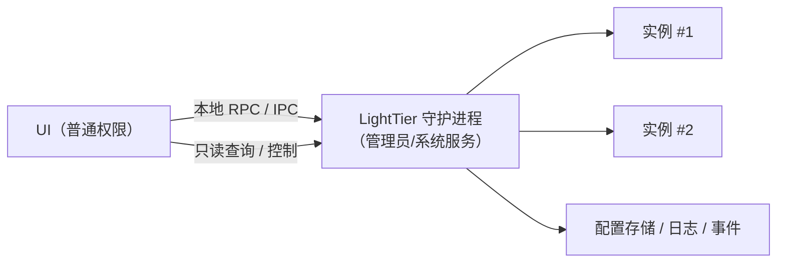
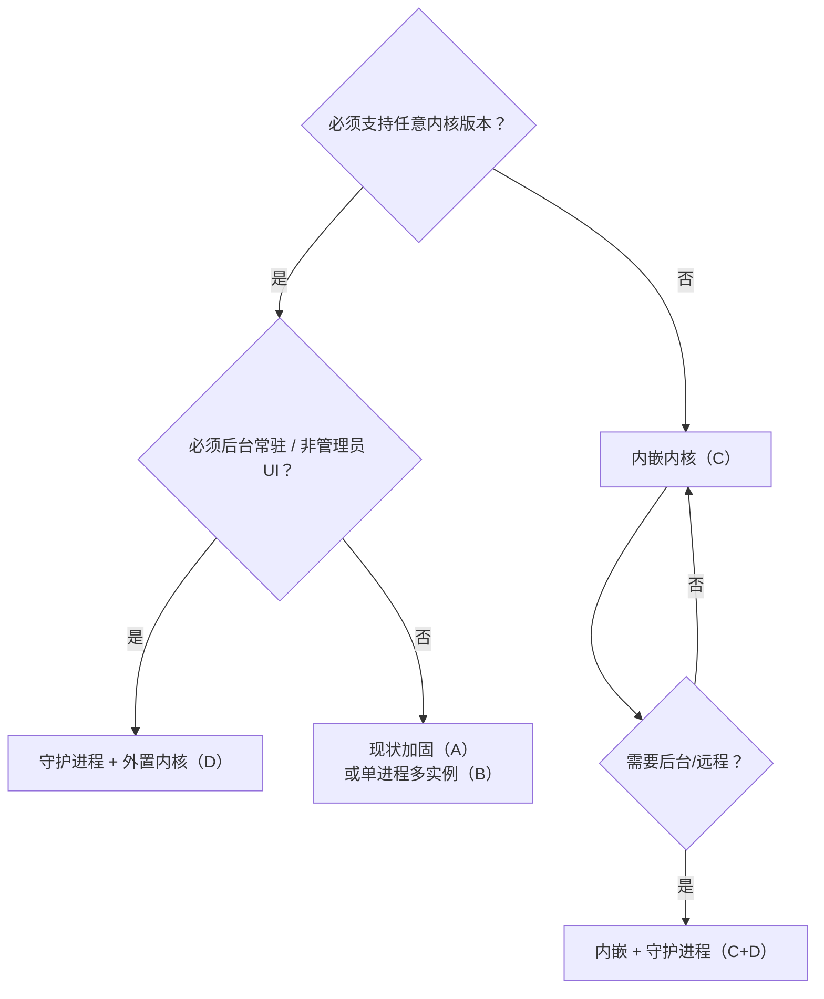
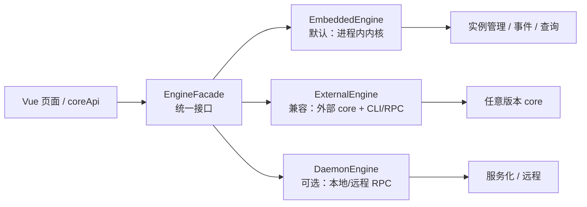

# EasyTier 接入架构调研：从「CLI + 多进程」到「内嵌内核 / 守护进程」

> 生成时间：2026-10-20
> 调研对象：LightTier 1.1.0（内置 EasyTier v2.6.4）+ EasyTier v2.7.0（Pre-release，官方新架构）
> 文档性质：架构调研与选型建议，未改动代码
> 相关文档：[EasyTier v2.7.0 升级适配方案](./EasyTier-v2.7.0-升级适配方案.md)、[EasyTier 各版本配置字段与 CLI 对照](./EasyTier-各版本配置字段与CLI对照.md)

---

## 0. 先回答三个问题

### 0.1 现在是「通过 CLI 创建实例」吗？

**是，但需要说得更准确一点。**

- **桌面端**：每个配置会拉起一个独立的 `easytier-core` 子进程，实例真正由这个内核进程创建。`easytier-cli` 不创建实例，它只是通过 RPC **查询/管理** 已经运行的内核。
- **Android 端**：已经不是 CLI 模式。内核以 Rust 库的形式跑在应用进程内，由 `NetworkInstanceManager` 管理，TUN 由 `VpnService` 提供 fd 后注入。
- **Windows 服务**：通过 `easytier-cli service install` 或 NSSM 把内核注册为系统服务，本质仍是「一个配置对应一个内核进程」。

所以更准确的说法是：

> **桌面端 = 一个配置一个 `easytier-core` 子进程 + `easytier-cli` 查询；Android 端 = 进程内嵌内核。**

### 0.2 有没有更好的 EasyTier 衍生方案？

**有，而且上游已经把路铺好了。**

EasyTier 现在不只是一个 CLI 程序，它同时提供了：

- 可移植的 Rust 内核库（`easytier` / `easytier-core` crate）；
- 进程内多实例管理器（`NetworkInstanceManager` / `InstanceManager`）；
- 完整的管理 RPC（创建、删除、采集状态、改配置）；
- 单进程多实例启动（`--config-dir`）；
- 内置服务管理与 `--daemon` 模式；
- FFI / Android JNI / Go / WASI / JavaScript 等多种宿主接入方式。

**官方 GUI 在 v2.7.0 已经改成内嵌内核**，不再靠外部 CLI 拉进程；同一份程序还可以作为系统服务在后台运行，GUI 通过本地 RPC 连接。这说明「内嵌 + 服务化」不是实验性方案，而是官方正在走的主路线。

### 0.3 最推荐的方向

一句话：

> **长期把「内嵌内核」作为默认运行方式，把「外置内核」保留为任意版本兼容模式；如果产品更看重后台常驻、非管理员界面和远程管理，再加一个「本地守护进程 + RPC」形态。**

不建议继续把「扫描进程命令行 + 每次查询启动一个 CLI」当作主架构。它可以继续工作，但它是当前大多数稳定性、性能和安全性问题的根源。

---

## 1. 现状拆解：LightTier 今天怎么用 EasyTier

### 1.1 一张图看懂



### 1.2 桌面端链路

| 环节 | 当前做法 | 代码位置 |
| --- | --- | --- |
| 启动 | 前端拼参数，经 Tauri `run_command` 拉起 `easytier-core --config-file ... --rpc-portal ...` | `src/utils/shellUtil.ts:294`、`src-tauri/src/lib.rs:106` |
| 查询节点/对等节点 | 每次查询启动一个 `easytier-cli`，传 `-p <rpc> --output json node/peer` | `src/utils/coreApi.ts:88`、`src/utils/shellUtil.ts:364` |
| 运行列表 | Windows 用 PowerShell `Get-CimInstance`，Unix 用 `ps`，扫描命令行里的 `.toml` 和 `--rpc-portal` | `src/utils/shellUtil.ts:479`、`src/utils/shellUtil.ts:580` |
| 停止 | `taskkill /F` 或 `kill -9` 按 PID 结束 | `src/utils/shellUtil.ts:427` |
| 服务 | NSSM 或 `easytier-cli service install` 两条路径 | `src/utils/shellUtil.ts` 服务管理段 |
| 权限 | 整个应用以管理员身份运行（Windows manifest `requireAdministrator`） | `src-tauri/build.rs:24` |
| 监控刷新 | 默认每 3 秒轮询一次，每个运行实例都要发一次 CLI 查询 | `src/views/new/monitor/index.vue:930` |

### 1.3 Android 端链路

Android 端是另一种模型，也是这次调研最重要的「现成样板」：

- `src-tauri/src/android/mod.rs` 直接依赖 `easytier` crate；
- 用 `NetworkInstanceManager` 管理实例；
- 用进程内 Ring Tunnel 承载 RPC（`ApiRpcServer` + `StandAloneClient`），对前端暴露与 CLI JSON 一致的数据结构；
- `set_tun_fd` 把 `VpnService` 建立的 TUN fd 注入内核；
- 受 Android 单 VPN 限制，采用单实例模型，启动新配置前先停旧实例。

也就是说，**LightTier 已经有一份可以工作的「进程内嵌内核」实现**，只是目前只在 Android 上启用。

### 1.4 现状的优点

- **实现直观**：一个配置一个进程，启动、停止、排障都容易理解。
- **版本自由**：用户可下载任意版本的 core zip，解压替换即可，这是 LightTier 的重要产品能力。
- **崩溃隔离**：单个内核进程崩溃不会拖垮整个 UI（虽然 UI 可能显示异常）。
- **边界清晰**：前端只依赖 `coreApi.ts`，平台差异已经被抽象过一层。

### 1.5 现状的痛点

| 现象 | 根因 | 影响 |
| --- | --- | --- |
| 运行列表偶尔多出/漏掉实例 | 靠扫描命令行匹配 `.toml` 文件名，其他程序也可能命中 | 状态不可信，用户困惑 |
| 监控页有持续 CPU/IO 开销 | 每 3 秒为每个实例启动一次 `easytier-cli` 进程 | 多实例时进程创建开销明显 |
| 内核与 CLI 版本可能不一致 | core 从资源目录启动，CLI 走 `PATH` 查找 | 查询字段/行为可能不匹配 |
| 虚拟 IP、DHCP、代理网段变化不能即时感知 | 没有事件流，只能轮询 | UI 延迟，排障困难 |
| RPC 端口冲突 | 每个实例都要分配一个 RPC 端口，靠预检 + 扫描规避 | 并发启动时仍有竞态 |
| 停止不够优雅 | 直接 `taskkill /F` / `kill -9` | 路由、虚拟网卡、日志可能残留 |
| 日志分散 | 每个 core 自己写文件，应用日志另有一套 | 问题关联困难 |
| 安全面偏大 | `run_command` / `run_cli` 接受任意 program + args，且应用是管理员权限 | 一旦 WebView 被注入，影响面是「管理员任意命令执行」 |
| 版本同步点多 | core zip、CLI、Android crate、常量四处同步 | 升级容易漏改 |

> 这些问题不代表现有方案「不能用」，而是说明它已经到了需要换架构的阶段。

---

## 2. EasyTier 的能力地图：它不只是一种用法

### 2.1 六种形态

| 形态 | 是什么 | 典型使用者 | 对 LightTier 的意义 |
| --- | --- | --- | --- |
| `easytier-core` 可执行文件 | 完整内核，支持配置文件、`--config-dir`、`--daemon`、服务模式 | 命令行用户、服务端 | 当前桌面端的外部进程；也可作为守护进程 |
| `easytier-cli` | 管理 RPC 的客户端，查询节点/对等节点/路由、管理服务、改运行参数 | 运维、排障 | 当前查询工具；不负责创建实例 |
| `easytier` / `easytier-core` Rust crate | 可嵌入的内核库，官方 GUI 使用 | Rust 宿主、官方 GUI | 桌面端内嵌的首选 |
| 管理 RPC | 进程级管理接口：创建/删除实例、采集状态、读取/修改配置 | 官方 GUI、Web 控制台、远程客户端 | 可替代「进程扫描 + CLI 轮询」 |
| config-server + Web 控制台 | 中心化管理面：网络、成员、地址、凭据、ACL | 团队/企业运维 | 与本地管理器互补，不替代本地 TUN |
| FFI / JNI / Go / WASI / JS | 给非 Rust 宿主或浏览器/边缘运行时使用 | Android JNI、Go、Cloudflare Workers | Tauri 本身是 Rust，直接依赖 crate 更简单 |

### 2.2 关键事实（容易被忽略）

1. **一个 `easytier-core` 进程可以跑多个实例。**
   `--config-dir <目录>` 会加载目录下所有 `.toml` 并逐个启动；`easytier-cli` 可以用 `-i/--instance-id` 或 `-n/--instance-name` 选择实例查询。v2.6.4 和 v2.7.0 都支持这个能力。

2. **`easytier-cli` 不能创建实例。**
   它只连接已经存在的内核 RPC，做查询、服务管理、运行参数调整。创建实例的是 `easytier-core` 进程或嵌入的 `InstanceManager`。

3. **管理 RPC 可以动态创建/删除实例。**
   协议中包含 `RunNetworkInstance`、`DeleteNetworkInstance`、`CollectNetworkInfo`、`GetNetworkInstanceConfig` 等方法。官方 GUI 和 Web 控制台都通过这层管理实例。

4. **官方 GUI v2.7.0 已经内嵌内核。**
   `easytier-gui/src-tauri/Cargo.toml` 直接依赖 `easytier` 和 `easytier-core`；`lib.rs` 使用 `NativeInstanceManager`、进程内/ TCP RPC、服务管理和移动端 TUN 注入。它不再靠外部 CLI 拉起内核。

5. **同一份程序可以「前台内嵌」也可以「后台服务」。**
   官方 GUI 支持 `--daemon` 服务模式：服务进程加载 `--config-dir` 下的配置并暴露 RPC，GUI 以远程模式连接。这样 UI 可以退出，网络仍在；UI 也可以不再以管理员身份运行。

6. **Web 控制台不是本地组网内核。**
   它负责「配置和成员管理」，不负责本机 TUN、路由、DNS。LightTier 的本地监控/配置编辑仍然有独立价值。

### 2.3 常见误解

| 误解 | 事实 |
| --- | --- |
| 「实例是 `easytier-cli` 创建的」 | 实例由 `easytier-core` 或内嵌 `InstanceManager` 创建；CLI 只是 RPC 客户端 |
| 「一个 core 只能一个实例」 | 一个进程可以管理多个实例；`--config-dir` 和 `NetworkInstanceManager` 都支持 |
| 「内嵌只能单实例」 | 官方 GUI 内嵌后仍支持多实例；Android 单实例是 VPN 系统限制，不是内嵌限制 |
| 「Web 控制台能替代桌面管理器」 | Web 管配置/成员，不管本机 TUN、路由和本地进程 |
| 「WASM/JS 版可以直接给桌面组网」 | 浏览器/边缘运行时没有系统 TUN 权限，不能替代本地内核 |
| 「官方 GUI 只是一个 CLI 壳」 | v2.7.0 已改为内嵌内核，并支持服务/远程模式 |

---

## 3. 六个可行方案

先给一张速览表，后面逐个展开。

| 方案 | 一句话 | 内核在哪 | 版本自由 | 改动量 | 推荐度 |
| --- | --- | --- | --- | --- | --- |
| A. 现状加固 | 保留多进程，但把命令、状态、权限收紧 | 每个配置一个子进程 | 高 | 小 | 必做，但不是终点 |
| B. 单进程多实例 | 一个 core 进程托管所有配置 | 一个子进程 | 高 | 中 | 适合服务模式，动态增删需 RPC |
| C. 内嵌内核 | 内核变成应用内的库 | UI 进程内 | 低（编译期固定） | 大 | 长期主方向 |
| D. 本地守护进程 + RPC | 内核跑在服务里，UI 只做驾驶舱 | 独立服务进程 | 高 | 大 | 后台/远程/非管理员优先时首选 |
| E. 官方 Web 控制台 | 中心化管理交给官方，LightTier 做本地 | 远端/本机内核 | 高 | 小 | 互补，不替代 |
| F. 上游衍生/共建 | 基于官方 GUI 或上游能力做二次开发 | 取决于上游 | 中 | 战略级 | 谨慎评估 |

---

### 方案 A：现状加固（CLI 多进程 + 受控 Sidecar）

**一句话：** 房子还是那几间，但把门锁、监控和消防先做好。



**做什么：**

1. 把 `run_command` / `run_cli` 这类「任意程序 + 任意参数」的命令，替换成类型化命令：
   - `start_core(config_file)`；
   - `stop_core(instance_id)`；
   - `query_node(instance_id)`；
   - `query_peer(instance_id)`；
   - `get_core_version()`。
2. 在 Rust 侧维护「实例 → PID / 配置 / RPC 端口 / 启动时间」状态表，不再靠扫描命令行识别实例。
3. `easytier-cli` 固定使用资源目录中的二进制，禁止走 `PATH`。
4. 用进程组 / Job Object 管理子进程，退出时统一清理；停止时先尝试优雅退出，超时再强杀。
5. 收窄 Tauri capability：移除 `cmd`、`powershell` 等宽泛授权，只保留实际需要的固定命令。
6. 把端口分配、RPC 端口、日志目录统一记录，减少竞态。

**优点：**

- 改动最小，风险最低；
- 保留任意版本内核的能力；
- 立刻消除最大的安全面和一部分状态误判；
- 可作为后续任何方案的过渡层。

**缺点：**

- 仍然是「多进程 + 轮询」，性能和实时性没有质变；
- 仍需处理 CLI 版本、进程生命周期、端口冲突；
- 内核事件仍然无法直达 UI。

**适合：** 近期版本必须稳定、暂时没有人力做大改造。

**粗估：** 1–2 周（不含完整回归）。

**结论：** 应该做，但它是「止血」，不是「治病」。

---

### 方案 B：单进程多实例（`--config-dir` + RPC）

**一句话：** 从「每户一台发电机」变成「一栋楼一台发电机」。



**做什么：**

1. 启动一个 `easytier-core --config-dir <配置目录> --rpc-portal <固定端口>`；
2. 目录下所有 `.toml` 自动加载为实例；
3. 查询时用 `easytier-cli -i <id>` 或 `-n <name>` 选择实例；
4. 服务模式下配合 `--daemon`，天然适合开机自启。

**关键限制：**

- `easytier-cli` **没有**「运行时新增/删除单个实例」的命令。如果 LightTier 要保持「逐个启动/停止配置」的交互，必须：
  - 自己实现管理 RPC 客户端，调用 `RunNetworkInstance` / `DeleteNetworkInstance`；或
  - 重启整个 core 进程（会打断其他实例，不可接受）。
- 一个进程崩溃会影响所有实例；
- 所有实例共享一个 core 版本；
- 端口、虚拟网段冲突仍然存在，只是从「进程间」变成「实例间」。

**优点：**

- 进程数量从 N 降到 1，启动/停止/日志/升级都更简单；
- 一个 RPC 端口，查询不再需要扫描进程；
- 非常适合「服务模式」：所有启用的配置随服务一起启动。

**缺点：**

- 动态增删需要额外的 RPC 客户端，工作量并不小；
- 故障隔离变差；
- 与现有「一配置一 PID」的 UI 状态模型不兼容，需要重构；
- 仍然依赖外部 core 二进制和 CLI 协议。

**适合：** 以「服务化、统一托管」为主，能接受实例生命周期由守护进程统一管理。

**粗估：** 静态启动/停止 2–3 周；动态实例管理 4–6 周。

**结论：** 是通往方案 D 的低成本跳板，但不建议作为最终形态单独存在。

---

### 方案 C：内嵌内核（Rust crate，推荐主方向）

**一句话：** 把发动机装进车里，而不是每辆车后面拖一台发电机。



**做什么：**

1. 在 `src-tauri` 引入 `easytier` + `easytier-core`（建议对齐 v2.7.0）；
2. 把现有 `src-tauri/src/android/mod.rs` 重构成跨平台的 `embedded` 模块：
   - 公共部分：`InstanceManager`、进程内 RPC、状态采集、事件订阅；
   - 平台部分：桌面 TUN、Android VpnService fd、权限处理；
3. 用 Tauri 命令直接暴露 `start_instance` / `stop_instance` / `list_instances` / `query_node` / `query_peer` / `query_routes`；
4. 用事件流替代轮询：实例状态、虚拟 IP、代理网段变化直接 `emit` 给前端；
5. 删除桌面端「进程扫描 + CLI 查询」默认路径；
6. 保留「外置内核」作为可选的版本兼容模式（见第 5 节双引擎）。

**优点：**

- **最快**：没有进程创建、CLI 启动、JSON 文本解析；
- **最准**：实例状态、事件、日志都来自同一个内核；
- **最统一**：桌面和 Android 共用一套实例管理代码；
- **最安全**：可以删掉 `run_command` / `run_cli` 和大部分 shell 权限；
- **体验最好**：支持实时事件、优雅停止、配置热更新、按实例采集指标；
- **官方同款**：官方 GUI v2.7.0 已经验证了这条路线。

**缺点：**

- **失去任意版本内核**：内嵌内核在编译期固定，用户不能再随意下载 v2.4/v2.6/v2.7 替换；
- 编译时间、二进制体积会增加；
- 上游 API 仍在演进（v2.7.0 把 core 拆成独立 crate），升级需要改代码；
- 内核与 UI 同进程，内核崩溃可能拖垮 UI；
- Windows 多实例多 TUN 需要实测；macOS/Linux 还需要提权 helper；
- 现有「管理员运行整个应用」的模式没有改变，安全提升有限（除非配合方案 D）。

**适合：** 以本地体验、稳定性、双端统一为优先，且能接受「内置版本为主、外置版本为辅」。

**粗估：** 4–8 周（含 v2.7.0 API 迁移、Windows 多实例回归、事件/查询改造）。

**结论：** 最值得作为长期默认架构。建议先做 1–2 周技术验证（spike），确认 Windows 多实例、TUN、权限、体积、构建时间，再正式排期。

---

### 方案 D：本地守护进程 + RPC（服务化）

**一句话：** 让「发动机」住在独立的机房，UI 只是驾驶舱。



**做什么：**

1. 提供一个无界面的守护进程模式：
   - 可以直接复用 `easytier-core --daemon --config-dir ... --rpc-portal ...`；
   - 也可以让 LightTier 自己的二进制支持 `--daemon`（官方 GUI 的做法）；
2. 安装为 Windows 服务（官方 service manager 或 NSSM）；
3. UI 通过 localhost TCP RPC 或命名管道连接；
4. 用管理 RPC 做实例创建/删除/采集/配置读写；
5. UI 不再需要管理员权限，服务进程独立运行；
6. 可选：开放远程 RPC（必须加认证/白名单/隧道）。

**优点：**

- **后台常驻**：UI 关闭，网络不断；
- **权限分离**：服务以管理员/系统运行，UI 以普通用户运行，安全面显著缩小；
- **远程管理**：同一套 RPC 可以支持远程客户端；
- **故障隔离**：UI 崩溃/升级不影响网络；
- **服务原生**：开机自启、守护、重启策略都更自然；
- **可与 B/C 组合**：守护进程内部可以是外部 core，也可以是内嵌内核。

**缺点：**

- RPC 是高权限接口，必须做好认证、绑定地址、白名单；
- 服务安装/升级/卸载/日志/权限都要额外处理；
- 跨版本 RPC 兼容性要维护；
- Windows 服务调试比前台进程麻烦；
- Android 不适用（继续用内嵌 + VpnService）。

**适合：** 产品定位包含「开机即连、后台常驻、远程管理、非管理员 UI」。

**粗估：** 4–8 周（复用上游 service/RPC；若自定义 IPC 则更久）。

**结论：** 如果「后台常驻/非管理员/远程」是核心诉求，这是最佳形态；它可以和方案 C 合并为「内嵌内核 + 可选守护进程」。

---

### 方案 E：官方 Web 控制台 / config-server（管理面补充）

**一句话：** 把「公司网络管理」交给官方控制台，LightTier 专注「本机驾驶舱」。

**做什么：**

- 保留并强化现有 Web 配置管理页：管理本机作为客户端接入 config-server 的进程生命周期；
- 网络、成员、地址、凭据、ACL 等集中管理，引导用户去官方 Web 控制台；
- 不在 LightTier 内重复建设中心化成员数据库。

**优点：**

- 官方持续维护，跟随内核演进；
- 团队/企业场景开箱即用；
- LightTier 可以少做一大块高维护成本的功能。

**缺点：**

- 依赖服务端/网络；
- 不解决本地 TUN、路由、进程管理；
- 数据治理和账号体系由官方/自建服务端决定。

**适合：** 作为方案 C/D 的补充，而不是替代。

**粗估：** 1–2 周（主要是入口、文案、状态联动）。

**结论：** 推荐保持「互补划界」，不要重复造中心化控制台。

---

### 方案 F：上游衍生 / 共建（战略选项）

**一句话：** 与其长期维护一个平行管理器，不如判断「哪些能力应该长在上游」。

有三个子选项：

| 子选项 | 做法 | 优点 | 风险 |
| --- | --- | --- | --- |
| F1. Fork 官方 GUI | 以官方 GUI 为底座，重新加回 LightTier 的配置编辑、主题、版本下载等差异功能 | 直接获得内嵌/服务/远程架构 | 产品定位不同、维护两套 UI、许可证与署名、上游冲突 |
| F2. 向上游贡献 | 把配置编辑、版本管理、主题等能力做成上游可接受的模块 | 维护成本最低、影响力最大 | 上游接受度不确定、节奏受制于人 |
| F3. 抽出 Tauri 插件 | 把 LightTier 的内嵌内核 + TUN + 实例管理抽成 `tauri-plugin-easytier` | 可复用、可开源、生态价值 | 抽象成本高、要兼容多平台 |

**结论：** 不建议现在整体 fork 官方 GUI。更现实的是：**参考其架构，不复制其实现**；中长期再评估 F2/F3。

> 许可证提示：EasyTier 为 LGPL-3.0，LightTier 为 AGPL-3.0。直接复用官方 GUI 代码前，需要确认许可证兼容、保留声明，并做一次法律/合规审查；仅参考架构和接口设计不构成复制。

---

### 不推荐作为桌面主路线的形态

| 形态 | 为什么不作为桌面主路线 |
| --- | --- |
| WASM / 浏览器版 | 没有系统 TUN、路由、DNS 权限，只能做应用层/边缘代理 |
| Go 绑定 | 适合 Go 宿主；Tauri 是 Rust，直接依赖 crate 更简单 |
| FFI / JNI | 适合非 Rust 宿主；LightTier 桌面/Android 都能直接写 Rust，没必要多一层 C ABI |
| `easytier-mini` | 精简内核，缺少完整功能（VPN portal、部分打洞/发现等），不适合做完整管理器 |

---

## 4. 方案对比

### 4.1 定性对比

| 维度 | A 现状加固 | B 单进程多实例 | C 内嵌内核 | D 守护进程 + RPC |
| --- | --- | --- | --- | --- |
| 内核位置 | 每配置一个子进程 | 一个子进程 | UI 进程内 | 独立服务进程 |
| 实例粒度 | 进程级 | 进程内多实例 | 进程内多实例 | 进程内多实例 |
| 任意版本内核 | 高 | 高 | 低（需外置兼容） | 高 |
| 实时事件 | 无 | 有（需 RPC 客户端） | 有 | 有 |
| 进程扫描 | 需要 | 不需要 | 不需要 | 不需要 |
| 查询开销 | 每次启动 CLI | 每次启动 CLI（可用 RPC 优化） | 极低 | 低 |
| 后台常驻 | 依赖服务/子进程 | 可以 | 依赖托盘/服务 | 天然 |
| UI 权限 | 管理员 | 管理员 | 管理员 | 普通用户（推荐） |
| 远程管理 | 困难 | 可以 | 可以 | 天然 |
| 故障隔离 | 好 | 差 | 差 | 好 |
| 改动量 | 小 | 中 | 大 | 大 |
| 维护成本 | 中 | 中 | 中高（跟上游 API） | 高（服务/RPC/权限） |

### 4.2 按目标选型

| 你的首要目标 | 建议 |
| --- | --- |
| 近期先稳住，不发生大改 | A，先把安全和状态管理补上 |
| 减少进程数量、做服务托管 | B，作为 D 的过渡 |
| 最好的本地体验、桌面/Android 统一 | C，作为长期默认 |
| 开机即连、后台常驻、非管理员 UI、远程 | D，或 C + D 组合 |
| 企业集中管理 | E，和 C/D 互补 |
| 不想长期维护平行架构 | F2/F3，向上游靠拢或抽插件 |

### 4.3 一个简单的决策树



---

## 5. 推荐路线：双引擎 + 可选守护进程

### 5.1 目标架构

不要做成「只能在 CLI 和内嵌之间二选一」。更好的做法是把「引擎」抽象出来：



统一接口建议包含：

```ts
interface CoreEngine {
  capabilities: {
    selectableVersion: boolean   // 是否支持任意内核版本
    supportsEvents: boolean      // 是否有实时事件
    supportsService: boolean     // 是否支持后台服务
    requiresAdmin: boolean       // 是否需要管理员权限
  }
  start(configFile: string): Promise<InstanceId>
  stop(instanceId: string): Promise<void>
  list(): Promise<InstanceInfo[]>
  queryNode(instanceId: string): Promise<NodeInfo>
  queryPeers(instanceId: string): Promise<PeerInfo[]>
  queryRoutes(instanceId: string): Promise<RouteInfo[]>
  onEvent(cb: (event: CoreEvent) => void): Unsubscribe
}
```

这样 UI 不需要知道「内核在哪」，只需要知道「当前引擎支持什么能力」。版本选择页也可以根据 `capabilities.selectableVersion` 决定是否显示「下载任意版本」。

### 5.2 分阶段实施

#### Phase 0：安全与可观测性止血（1 周左右）

- 用类型化命令替换 `run_command` / `run_cli`；
- 固定 core/CLI 路径，不再走 `PATH`；
- Rust 侧记录实例状态（PID、配置、RPC 端口、启动时间）；
- 退出/停止时清理进程树，先优雅后强杀；
- 收窄 capability，移除不必要的 `cmd` / `powershell` 授权；
- 为「运行列表」「查询」「停止」补集成测试。

> 这一阶段不改变架构，但能立刻降低风险，也为后续引擎抽象打基础。

#### Phase 1：引擎抽象 + 外置引擎（2–3 周）

- 在 `coreApi.ts` 与 Rust 之间引入 `CoreEngine` 概念；
- 把现有 CLI 多进程实现包装成 `ExternalEngine`；
- 保留现有 UI 行为，先做到「换引擎不影响页面」；
- 增加能力探测（版本、是否支持事件、是否需要管理员）。

#### Phase 2：桌面内嵌内核（4–8 周，建议先 spike）

- 以 v2.7.0 为目标，先做 1–2 周技术验证：
  - Windows 多实例、多 TUN 是否稳定；
  - 管理员权限下 TUN/路由/DNS 是否正常；
  - 二进制体积、构建时间、内存占用；
  - v2.7.0 API 迁移工作量。
- 验证通过后，把 Android 的 `android/mod.rs` 抽成跨平台 `embedded` 模块；
- 桌面 TUN 由内核直接创建，不需要 VpnService fd；
- 用进程内 RPC 或直接调用 `InstanceManager` 提供查询；
- 用事件流替代监控轮询；
- 默认走内嵌；「下载任意版本」切换为 `ExternalEngine`。

#### Phase 3：守护进程 / 服务化（可选，4–8 周）

- 让同一份二进制支持 `--daemon`，或直接使用 `easytier-core --daemon --config-dir`；
- 安装为 Windows 服务；
- UI 通过 localhost RPC 连接，普通权限运行；
- 增加 RPC 认证/白名单/日志脱敏；
- 远程管理作为独立开关，默认关闭。

#### Phase 4：清理与上游同步

- 删除进程扫描、CLI 文本解析、NSSM 双路径等历史逻辑；
- 统一日志、配置、版本展示；
- 建立与上游 tag 的同步节奏和兼容性测试。

### 5.3 如果只能做一件事

**把默认运行路径切到内嵌内核，外置内核只保留为版本兼容模式。**

理由：

- 它同时解决实时性、进程扫描、CLI 版本不一致、查询开销、事件缺失等最多问题；
- 它和 Android 现有实现同源，代码复用最高；
- 官方 GUI 已经验证，技术风险可控；
- 版本自由可以通过「双引擎」保留，不必牺牲产品能力。

如果产品的第一优先级是「后台常驻 + 非管理员 UI」，则反过来：**先做守护进程，再考虑是否内嵌**。

### 5.4 决策清单

在立项前，建议明确回答：

- [ ] 是否必须支持用户下载任意 EasyTier 版本？
- [ ] 是否接受「UI 退出 = 网络断开」？如果不接受，必须做守护进程/服务。
- [ ] 是否要求 UI 以普通用户权限运行？
- [ ] 是否需要远程管理/多端管理？
- [ ] 团队是否能持续跟进 EasyTier v2.7+ 的 API 变化？
- [ ] Windows 之外（macOS/Linux）是否在近期范围内？
- [ ] 是否接受二进制体积和构建时间增加？
- [ ] 是否需要对官方 GUI 代码做许可证审查？

### 5.5 验收指标（建议先测基线）

| 指标 | 现状（待测） | 目标 |
| --- | --- | --- |
| 启动一个配置耗时 | 记录基线 | 内嵌后明显下降 |
| 监控页每 3 秒 CPU/进程创建数 | 记录基线 | 内嵌后接近 0 额外进程 |
| 运行列表准确率 | 记录误报/漏报 | 100%（状态来自内核） |
| 停止后路由/网卡残留 | 记录 | 0 |
| 安装包体积 | 记录 | 可接受范围内 |
| 冷启动/构建时间 | 记录 | 可接受范围内 |
| 内核崩溃恢复 | 记录 | UI 可感知并可重启实例 |

---

## 6. 如果走内嵌/守护，落地要注意什么

### 6.1 复用现有 Android 代码

Android 模块已经解决了大部分「进程内内核」的难题：

- `InstanceManager` 的创建/删除/列举；
- 进程内 Ring RPC；
- 与 CLI JSON 对齐的 peer/node 数据结构；
- 事件订阅（DHCP、代理网段）；
- TUN fd 注入。

桌面端要补的主要是：

- 桌面 TUN 直接创建（不经过 VpnService）；
- Windows 管理员权限下的网卡/路由/DNS 处理；
- 多实例多 TUN 的回归测试；
- 桌面服务模式（可选）。

### 6.2 权限模型

| 平台 | 现状 | 内嵌后 | 守护进程后 |
| --- | --- | --- | --- |
| Windows | 整个应用管理员 | 不变（可先保持） | 服务管理员，UI 普通用户 |
| Android | VpnService 授权 | 不变 | 不适用 |
| macOS/Linux | 当前后端支持有限 | 需要提权 helper | 服务以 root 运行，UI 普通用户 |

Windows 已经有 `requireAdministrator` manifest，内嵌可以直接复用；但长期看，**把管理员权限收进服务、让 UI 普通权限运行** 是更安全的模型。

### 6.3 版本策略

内嵌后，内核版本 = 应用编译版本。建议：

- 固定精确 tag（不要用 semver 范围），记录 commit；
- `BUILTIN_CORE_VERSION`、Android Cargo tag、桌面 Cargo tag、资源 zip 四处同步；
- UI 明确显示「内置内核 vX」与「外置内核 vY」；
- 配置兼容检查继续保留（见 v2.7.0 升级文档的版本感知方案）；
- 外置模式只作为「版本兼容/回退」入口，不作为默认路径。

### 6.4 守护进程的 RPC 安全

管理 RPC 能创建/删除实例、读取/修改配置，属于高权限接口。最低要求：

- 只绑定 `127.0.0.1`，不要监听 `0.0.0.0`；
- 使用端口白名单/防火墙；
- 远程模式必须加认证（token/证书/隧道），默认关闭；
- 日志脱敏，避免泄露网络密钥；
- 服务账户权限最小化，配置目录 ACL 收紧；
- 对 RPC 调用做审计日志。

### 6.5 迁移与兼容

- 保留现有配置文件路径和格式，避免用户迁移成本；
- 实例 ID 要稳定：优先使用配置中的 `instance_id`，不要每次启动生成新 ID；
- 服务名、日志目录、路由清理逻辑要迁移；
- NSSM 路径逐步废弃，统一到官方 service manager 或自建服务；
- 旧版本外置内核仍走兼容路径，UI 用能力标记区分。

### 6.6 工作量粗估

| 工作包 | 内容 | 粗估 |
| --- | --- | --- |
| Spike | v2.7.0 内嵌验证（Windows 多实例/TUN/体积/构建） | 1–2 周 |
| 引擎抽象 | CoreEngine 接口、ExternalEngine 包装、能力探测 | 2–3 周 |
| 桌面内嵌 | embedded 模块、TUN、查询、事件、生命周期 | 4–6 周 |
| 服务化（可选） | daemon、服务安装、RPC 客户端、权限分离 | 4–6 周 |
| 测试/文档/发布 | 回归、兼容矩阵、迁移说明 | 2–3 周 |

> 以上为粗略工程估算，不含设计评审、法务审查和不可预见的上游变更。

### 6.7 风险清单

| 风险 | 说明 | 应对 |
| --- | --- | --- |
| v2.7.0 仍是 Pre-release | API 可能继续调整 | 先 spike，锁定 tag，建立升级测试 |
| 上游 API 重构 | v2.7.0 已把 core 拆成独立 crate | 参考官方 GUI 的用法，减少自写适配 |
| Windows 多实例多 TUN | 官方 GUI 支持，但 LightTier 未验证 | 专项回归：网卡命名、路由、DNS、指标 |
| 二进制体积/构建时间 | 内嵌会引入完整内核依赖 | 先测量，再决定是否保留外置模式 |
| 许可证 | EasyTier LGPL-3.0，LightTier AGPL-3.0 | 复用代码前做合规审查，保留声明 |
| RPC 安全 | 管理 RPC 权限很高 | 默认 localhost、认证、白名单、审计 |
| 管理员权限 | 现状 UI 即管理员 | 短期保持；长期用守护进程分离权限 |
| Android 单实例 | 系统单 VPN 限制 | 保持单实例模型，不做多实例承诺 |
| 用户版本自由 | 内嵌后不能用任意版本 | 双引擎保留外置模式，UI 明确标识 |

---

## 7. 结论

### 7.1 直接回答

- **现在是不是 CLI 创建实例？** 桌面端是「`easytier-core` 子进程创建实例，`easytier-cli` 查询」；Android 端已经是进程内嵌内核。
- **有没有更好的方案？** 有。上游已经提供可嵌入内核、多实例管理器、管理 RPC、单进程多实例、服务化、FFI/JNI 等能力，官方 GUI v2.7.0 也已转为内嵌内核。
- **推荐什么？** 长期采用「内嵌内核为主 + 外置内核兜底」的双引擎；如果后台常驻/非管理员/远程是核心诉求，再加「本地守护进程 + RPC」。

### 7.2 推荐落地顺序

1. **先止血**：类型化命令、固定路径、状态表、权限收窄（方案 A）。
2. **做抽象**：引入 `CoreEngine`，把现有 CLI 实现包装成 `ExternalEngine`。
3. **做验证**：v2.7.0 桌面内嵌 spike，测 Windows 多实例/TUN/体积/构建。
4. **切默认**：内嵌成为默认引擎，外置只用于版本兼容。
5. **再服务化**：如果产品需要，增加 `--daemon` 和 RPC，UI 降权。
6. **最后清理**：删除进程扫描、CLI 解析、NSSM 双路径等历史逻辑。

### 7.3 不建议做的事

- 继续加厚「扫描进程命令行 + 每次查询启动 CLI」的主路径；
- 为了省事把所有实例塞进一个 core 进程，却不做动态实例 RPC（会破坏逐个启停体验）；
- 直接整体 fork 官方 GUI（产品定位、UI、许可证、维护成本都要重新承担）；
- 在没有 RPC 认证的情况下开放守护进程/远程管理；
- 在没有实测的情况下假设「内嵌一定更小/更快」——体积和构建时间必须先测。

---

## 附录 A：关键代码证据

| 主题 | 文件 | 说明 |
| --- | --- | --- |
| 桌面启动/停止/查询分发 | `src/utils/coreApi.ts:45-126` | 桌面走 CLI，Android 走进程内命令 |
| 桌面拉起 core | `src/utils/shellUtil.ts:294-346` | 每配置一个进程，RPC 端口自动分配 |
| CLI 调用 | `src/utils/shellUtil.ts:364-380` | `easytier-cli` 走 shell/PATH |
| 进程扫描 | `src/utils/shellUtil.ts:479-610` | PowerShell CIM / ps 解析命令行 |
| 任意命令执行 | `src-tauri/src/lib.rs:69-138` | `run_cli` / `run_command` 接受 program + args |
| 管理员 manifest | `src-tauri/build.rs:24` | `requireAdministrator` |
| Android 内嵌 | `src-tauri/src/android/mod.rs:1-10` | 进程内内核、Ring RPC、TUN fd |
| Android 实例管理 | `src-tauri/src/android/mod.rs:215-325` | 单实例模型、列表、查询 |
| 监控轮询 | `src/views/new/monitor/index.vue:930` | 默认 3 秒轮询 |
| capability | `src-tauri/capabilities/default.json` | shell 执行范围较宽 |

## 附录 B：术语表

| 术语 | 含义 |
| --- | --- |
| 内核 / core | EasyTier 的组网数据面与控制面实现，负责 TUN、路由、加密、发现、打洞等 |
| `easytier-core` | 内核可执行文件，可独立运行、加载配置、作为服务 |
| `easytier-cli` | 管理 RPC 的命令行客户端，用于查询/管理已运行内核 |
| `InstanceManager` / `NetworkInstanceManager` | 进程内实例管理器，负责创建/删除/列举/采集实例 |
| 管理 RPC | 进程级控制接口（创建/删除实例、采集状态、配置读写） |
| TUN | 虚拟网卡，桌面由内核创建，Android 由 VpnService 提供 fd |
| 守护进程 / daemon | 无界面、常驻、通常以服务权限运行的内核宿主 |
| Sidecar | 随应用分发、由应用拉起的辅助进程（这里指 core） |
| 双引擎 | 同一 UI 下同时支持内嵌内核与外置内核的架构 |

## 附录 C：参考资料

- [EasyTier 仓库](https://github.com/EasyTier/EasyTier)（LGPL-3.0）
- [EasyTier 中文 README](https://github.com/EasyTier/EasyTier/blob/main/README_CN.md)
- [EasyTier Core Architecture](https://github.com/EasyTier/EasyTier/blob/main/docs/core-architecture.md)
- [EasyTier v2.7.0 Release](https://github.com/EasyTier/EasyTier/releases/tag/v2.7.0)
- [EasyTier 官方 GUI（v2.7.0 源码）](https://github.com/EasyTier/EasyTier/tree/v2.7.0/easytier-gui)
- [EasyTier CLI 源码](https://github.com/EasyTier/EasyTier/blob/v2.7.0/easytier/src/easytier-cli.rs)
- [EasyTier Core 启动逻辑（config-dir / daemon）](https://github.com/EasyTier/EasyTier/blob/v2.7.0/easytier/src/core.rs)
- [EasyTier 管理 RPC 协议](https://github.com/EasyTier/EasyTier/blob/v2.7.0/easytier-proto/proto/api_manage.proto)
- [EasyTier FFI](https://github.com/EasyTier/EasyTier/tree/v2.7.0/easytier-contrib/easytier-ffi)
- [EasyTier Android JNI](https://github.com/EasyTier/EasyTier/tree/v2.7.0/easytier-contrib/easytier-android-jni)
- [EasyTier mini](https://github.com/EasyTier/EasyTier/tree/v2.7.0/easytier-contrib/easytier-mini)
- [EasyTier JS](https://github.com/EasyTier/EasyTier/tree/v2.7.0/easytier-js)
- [EasyTier 一键注册服务文档](https://easytier.cn/guide/network/oneclick-install-as-service.html)
- [EasyTier 完整配置选项](https://easytier.cn/guide/network/configurations.html)
- [LightTier 现有 v2.7.0 升级适配方案](./EasyTier-v2.7.0-升级适配方案.md)

## 附录 D：更新记录

| 日期 | 变更 |
| --- | --- |
| 2026-10-20 | 初版：现状拆解、六个方案、对比与分阶段路线 |
